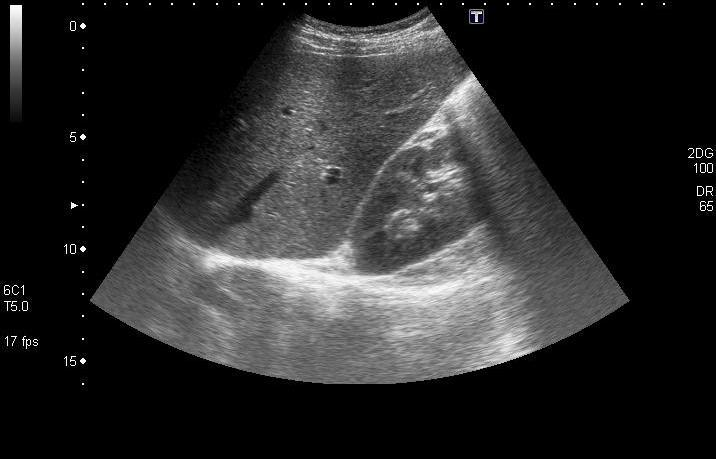
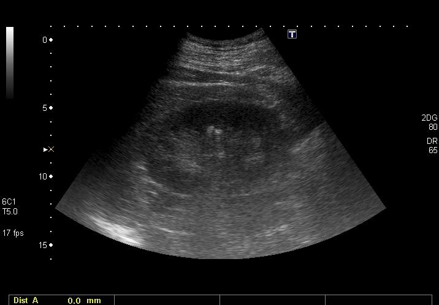
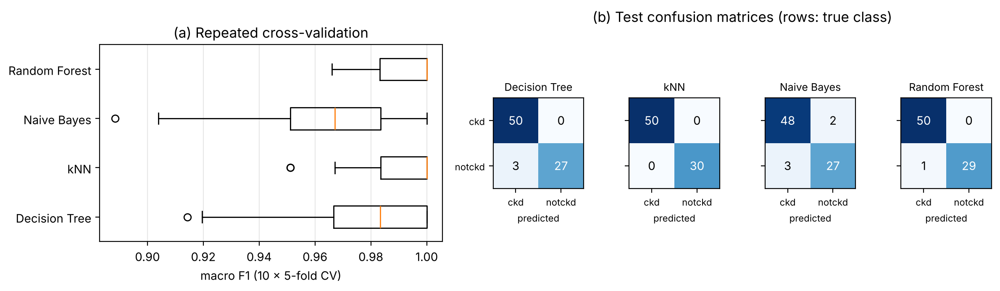
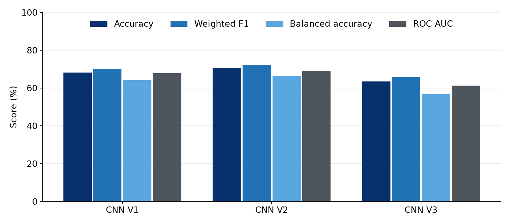

# F21DL PG Group 13

---

## Project Title: Predicting Chronic Kidney Disease

We chose this topic because chronic kidney disease (CKD) is a large and growing health problem. In 2023 it affected about **788 million adults (14% of all adults)**, more than double the 378 million in 1990, and it was the **ninth leading cause of death**, with 1.48 million deaths ([GBD 2023, The Lancet, 2025](https://pubmed.ncbi.nlm.nih.gov/41213283/)). Most of these cases are at an early stage, where the disease is often silent but can still be slowed. Since it can be detected with routine blood and urine tests, predicting CKD from this data is a practical way to support earlier diagnosis.

Full report: [report.pdf](report/report.pdf) · Change history: [CHANGELOG.md](CHANGELOG.md)

---

## Group Members
| Name | GitHub |
|---|---|
| Mohamed Elgazar | [elgazar24](https://github.com/elgazar24) |
| Vishwas More | [VishwasMore](https://github.com/VishwasMore) |
| Aisan Mojahedi | [amojahedi](https://github.com/amojahedi) |
| Gül Öner | [gullprojects](https://github.com/gullprojects) |
| Afzal Patel | [aap4006](https://github.com/aap4006) |
| Pratham Prashant Shah | [username] |

---

## Research Objectives
- Compare four classical models (Decision Tree, kNN, Naive Bayes, Random Forest) to find which predicts CKD best, using macro F1 (R3).
- Identify which features matter most and whether the engineered ones help (R2, R3).
- Check whether clustering groups patients in a way that matches the CKD diagnosis (R2).
- Build and tune CNN models and find how well they classify healthy and pathological kidney ultrasound images (R4).

---

## Project Milestones
The detailed tasks for each week are in our Trello board and we assign them in our weekly online meeting. W1 starts on 14 September 2026.

| Planned | Milestone | Req. | Status | Finished |
|---|---|---|---|---|
| W1-W3 | Team, GitHub repo and tools set up, coursework reviewed | Setup | done | W3 |
| W2-W4 | Topic, research questions, dataset comparison and choice | R1 | done, main dataset changed in W8 | W8 |
| W3-W5 | Data exploration (statistics, class balance, clinical signals) | R2 | done | W8 |
| W4 | Project pitch and slides | D1 | done | W4 |
| W4-W6 | Preprocessing (missing values, encoding, scaling) | R2 | done | W8 |
| W4-W7 | Feature engineering and feature selection | R2 | done | W8 |
| W5 | README proposal, up to the milestones | D1 | done | W5 |
| W7-W8 | Clustering compared with the CKD diagnosis | R2 | done | W8 |
| W8-W9 | Classical models: Decision Tree, Naive Bayes, kNN, Random Forest | R3 | done | W9 |
| W8-W10 | CNN models on ultrasound images (added in W8) | R4 | done | W10 |
| W9-W10 | MLP neural network, build and tune | R4 | to do | |
| W10-W11 | Evaluation and comparison (macro F1, confusion matrices) | R3 | done for classical models | W9 |
| W11 (25 Nov) | Final report, code and README | D2 | in progress | |
| W12 | Viva and peer assessment | D3, D4 | to do | |

<details>
<summary>MoSCoW: plan at the pitch and outcome</summary>

| Priority | Plan at the pitch | Outcome |
|---|---|---|
| Must | Clean data | done |
| Must | 3+ classical models | done (four) |
| Must | MLP | not built; CNN models built |
| Must | Macro F1 evaluation, report and code | evaluation done, report in progress |
| Should | Class imbalance handling, feature selection, clustering, tuning | done |
| Could | Test on a third dataset, demo | CKD Clinical Dataset tested, then rejected (see below) |
| Won't | Image/CNN models | changed: CNN added in W8 |
| Won't | Clinical deployment | kept |

</details>

<details>
<summary>Pipeline changes and reasons</summary>

| Date | Change | Reason |
|---|---|---|
| 31 Oct to 2 Nov | Main dataset changed from Kidney Disease Dataset (Kaggle) to UCI CKD | Kaggle labels carry no clinical signal; CKD Clinical labels are built from its own lab features (Random Forest scored 1.000) |
| 5 Nov | Four data stages: original, cleaned, feature engineered, preprocessed | Same train/test split and features for every model |
| 7 Nov | URI-CAD ultrasound images added | Image data for the CNN models |

Details: [CHANGELOG.md](CHANGELOG.md)

</details>

---

## Datasets
We use two independent datasets: tabular clinical data and renal ultrasound images. They are not linked, so their results are evaluated separately.

| | DS1: UCI Chronic Kidney Disease | DS2: URI-CAD |
|---|---|---|
| Link | [UCI](https://archive.ics.uci.edu/dataset/336/chronic+kidney+disease), [doi:10.24432/C5G020](https://doi.org/10.24432/C5G020) | [e-cienciaDatos](https://doi.org/10.21950/0E0CTF), [paper](https://doi.org/10.1007/s10278-024-01055-4) |
| True source | Apollo Hospitals, Karaikudi, India; Rubini, Soundarapandian and Eswaran (2015) | Hospital Universitario Ramón y Cajal, Madrid; Molina-Moreno et al. (2024) |
| Collection | about two months of hospital records | B-mode ultrasound, 2009 to 2018, one image per clinical case, labelled by two nephrologists |
| License | [CC BY 4.0](https://creativecommons.org/licenses/by/4.0/) | [CC BY-NC 4.0](https://creativecommons.org/licenses/by-nc/4.0/) |
| Size | 400 patients, 24 features (14 numeric, 10 yes/no or category) | 1,985 images |
| Classes | CKD 250 (62.5%), not CKD 150 (37.5%) | healthy 450 (22.7%), pathological 1,535 (77.3%) |
| Missing data | 242 of 400 patients (60.5%) have at least one gap | none |
| Extra data collected | none | none |
| Personal data | no names or IDs | anonymised by the source |
| In this repo | [folder](assets/datasets/1_UCI_Chronic_Kidney_Disease_Dataset), [statistics](assets/datasets/1_UCI_Chronic_Kidney_Disease_Dataset/info.md) | [folder](assets/datasets/URI_CAD_Dataset) |

The MIT licence of this repository covers the code only. Each dataset keeps its own licence.

### Two examples from each dataset
**DS1**

| Age | BP | Specific gravity | Albumin | Creatinine | Urea | Hemoglobin | Hypertension | Diabetes | Class |
|---|---|---|---|---|---|---|---|---|---|
| 48 | 70 | 1.005 | 4 | 3.8 | 56 | 11.2 | yes | no | ckd |
| 40 | 80 | 1.025 | 0 | 1.2 | 10 | 15.0 | no | no | notckd |

**DS2**

| Healthy (`25.jpg`) | Pathological (`1.jpg`) |
|---|---|
|  |  |

<details>
<summary>Comparison of the four tabular datasets we considered</summary>

| | $\color{green}{\textsf{UCI CKD (chosen, DS1)}}$ | Kidney Disease Dataset | CKD Clinical Dataset | BD-KDD |
|---|---|---|---|---|
| Link | [UCI](https://archive.ics.uci.edu/dataset/336/chronic+kidney+disease) | [Kaggle](https://www.kaggle.com/datasets/amanik000/kidney-disease-dataset) | [Kaggle](https://www.kaggle.com/datasets/priyankabarik/chronic-kidney-disease-ckd-clinical-dataset) | [Harvard Dataverse](https://dataverse.harvard.edu/dataset.xhtml?persistentId=doi:10.7910/DVN/MB1LES) |
| Folder | `1_UCI...` | `2_KG...` | `3_KG...` | `4_BD-KDD...` |
| Records | 400 | 20,538 | 25,800 | 988 |
| Features | 24 | 42 | 35 | 24 |
| Target | yes/no | 5 risk levels | 5 CKD stages | yes/no |
| Missing data | 60% of rows | none | none | none |
| Core blood and urine tests (creatinine, urea, hemoglobin, albumin) | yes | yes | yes | yes |
| eGFR (main kidney function measure) | no | yes | yes | no |
| Urine microscopy (red cells, pus cells, bacteria) | yes | yes | no | yes |
| Diabetes and hypertension | yes | yes, plus years with each | yes | yes |
| Why / why not | real patient outcomes, used in earlier studies | labels carry no clinical signal, licence unknown | labels built from its own lab features, so a model scores 1.000 | labels carry no clinical signal (highest correlation 0.10) |

</details>

---

## Installation
### Requirements
Python 3.12 (notebooks tested on 3.12.16). All packages are in [requirements.txt](requirements.txt). The data is already in the repository, so nothing else has to be downloaded.

### Setup steps
```bash
git clone https://github.com/elgazar24/f21dl-2026-27-PG-group-13.git
cd f21dl-2026-27-PG-group-13
python3 -m venv .venv
source .venv/bin/activate
pip install -r requirements.txt
```
On Windows, activate with `.venv\Scripts\activate`.

---

## Data Preparation
### How to run
Run from the repository root, in this order:
```bash
jupyter nbconvert --to notebook --execute --inplace src/notebooks/1_Data_Exploration/00_main.ipynb
jupyter nbconvert --to notebook --execute --inplace src/notebooks/3_Feature_Engineering/Feature_Engineering.ipynb
jupyter nbconvert --to notebook --execute --inplace src/notebooks/2_Data_Analysis/Data_Preprocessing/Data_Preprocessing.ipynb
jupyter nbconvert --to notebook --execute --inplace src/notebooks/4_Feature_Selection/00_main.ipynb
jupyter nbconvert --to notebook --execute --inplace src/notebooks/2_Data_Analysis/Clustering/Clustering.ipynb
```

### Pipeline steps
| Step | Notebook | Reads | Writes |
|---|---|---|---|
| 1. Explore and clean | [1_Data_Exploration](src/notebooks/1_Data_Exploration/00_main.ipynb) | `0_original_data` | shows the report; `1_cleaned_data` is stored in the repo |
| 2. Engineer 6 features | [Feature_Engineering](src/notebooks/3_Feature_Engineering/Feature_Engineering.ipynb) | `1_cleaned_data` | `2_feature_engineered_data` |
| 3. Split 80/20, impute, log, encode, scale | [Data_Preprocessing](src/notebooks/2_Data_Analysis/Data_Preprocessing/Data_Preprocessing.ipynb) | `2_feature_engineered_data` | `3_preprocessed_data` (320 train, 80 test) |
| 4. Select 15 features (Random Forest) | [4_Feature_Selection](src/notebooks/4_Feature_Selection/00_main.ipynb) | training set | `selected_features` in [config.json](configs/config.json) |
| 5. Cluster | [Clustering](src/notebooks/2_Data_Analysis/Clustering/Clustering.ipynb) | training set | results in the notebook |

The split is stratified with seed 42. Imputation, log transform and scaling are fitted on the training set only. DS2 images are prepared inside the CNN notebooks.

---

## Requirements and Results
### R2: Data analysis
| | |
|---|---|
| Input | DS1, 400 patients, 24 features |
| Output | 320 train and 80 test patients, 30 features, no missing values |
| Engineered features | comorbidity count, urea/creatinine ratio, log urea, log creatinine, urine abnormality score, urea x creatinine |
| Clustering | k-means, hierarchical (Ward), Gaussian mixture, DBSCAN; labels used only to check the result |
| Location | [exploration](src/notebooks/1_Data_Exploration/00_main.ipynb), [feature engineering](src/notebooks/3_Feature_Engineering/Feature_Engineering.ipynb), [preprocessing](src/notebooks/2_Data_Analysis/Data_Preprocessing/Data_Preprocessing.ipynb), [feature selection](src/notebooks/4_Feature_Selection/00_main.ipynb), [clustering](src/notebooks/2_Data_Analysis/Clustering/Clustering.ipynb) |

| Clustering method | Silhouette | Adjusted Rand index with the diagnosis |
|---|---|---|
| k-means (k = 2) | 0.278 | 0.299 |
| Hierarchical, Ward (k = 2) | 0.205 | 0.867 (0.480 with numeric features only) |
| Gaussian mixture (k = 2) | 0.213 | 0.342 |
| DBSCAN (best eps, 63% noise) | | 0.68 |

### R3: Classical models
| | |
|---|---|
| Input | preprocessed DS1 features; each model selects its own |
| Output | `ckd` or `notckd` |
| Evaluation | 10 x 5-fold stratified cross-validation on 320 patients, then 80 test patients |
| Location | [Decision Tree](src/notebooks/Models/Decision_Tree/Decision_Tree.ipynb), [Naive Bayes](src/notebooks/Models/Naive_Bayes/Naive_Bayes.ipynb), [kNN](src/notebooks/Models/KNN/KNN.ipynb), [Random Forest](src/notebooks/Models/random_forest/Random_Forest.ipynb), [comparison](src/notebooks/Models/Comparison/Model_Comparison.ipynb) |

| Model | Features | CV macro F1 (std) | CV CKD recall | Test accuracy | Test macro F1 | Test ROC AUC | CKD missed / false alarms |
|---|---|---|---|---|---|---|---|
| kNN | 15 | **0.993** (0.012) | 0.992 | **1.000** | **1.000** | **1.000** | 0 / 0 |
| Random Forest | 15 | **0.993** (0.011) | **1.000** | 0.988 | 0.987 | **1.000** | 0 / 1 |
| Decision Tree | 3 used | 0.979 (0.024) | 0.988 | 0.963 | 0.959 | 0.954 | 0 / 3 |
| Naive Bayes | 3 | 0.966 (0.025) | 0.958 | 0.938 | 0.933 | 0.982 | 2 / 3 |



To run the models:
```bash
jupyter nbconvert --to notebook --execute --inplace src/notebooks/Models/Decision_Tree/Decision_Tree.ipynb
jupyter nbconvert --to notebook --execute --inplace src/notebooks/Models/Naive_Bayes/Naive_Bayes.ipynb
jupyter nbconvert --to notebook --execute --inplace src/notebooks/Models/KNN/KNN.ipynb
jupyter nbconvert --to notebook --execute --inplace src/notebooks/Models/random_forest/Random_Forest.ipynb
jupyter nbconvert --to notebook --execute --inplace src/notebooks/Models/Comparison/Model_Comparison.ipynb
```

### R4: Neural networks
| | |
|---|---|
| Input | DS2 ultrasound images, 224 x 224 pixels |
| Output | healthy or pathological |
| Split | 1,389 train, 298 validation, 298 test (stratified) |
| Location | [CNN V1 to V3](src/notebooks/Models/CNN/CNN.ipynb) (needs an NVIDIA GPU) |
| Later experiments, not in the table | [V4 transfer learning](src/notebooks/Models/CNN%20with%20TL/CNN_V4_TL.ipynb), [V5 transfer learning](src/notebooks/Models/CNN%20with%20TL/CNN_V5_TL.ipynb), [V5](src/notebooks/Models/CNN/CNN_V5.ipynb), [V6](src/notebooks/Models/CNN/CNN_V6.ipynb) |

| Model | Set | Accuracy | Weighted F1 | Balanced accuracy | ROC AUC |
|---|---|---|---|---|---|
| CNN V1 (baseline) | validation | 68.12% | 70.18% | 64.07% | 67.78% |
| CNN V2 (normalisation, rotation) | validation | **70.47%** | **72.22%** | **66.12%** | **69.07%** |
| CNN V3 (batch norm, smaller) | validation | 63.42% | 65.71% | 56.80% | 61.34% |
| **CNN V2 (chosen)** | **test** | 67.11% | 68.94% | 61.09% | 67.58% |
| Always "pathological" | test | 77.18% | | 50.00% | 50.00% |



---

## Repository Structure
```
assets/datasets/    datasets (DS1 stages are numbered 0 to 3, DS2 is URI_CAD_Dataset)
assets/docs/        pitch notes and coursework documents
configs/            config.json: paths, seed, features
report/             LaTeX report, figures and PDF
src/notebooks/      exploration, analysis, features and models
```
